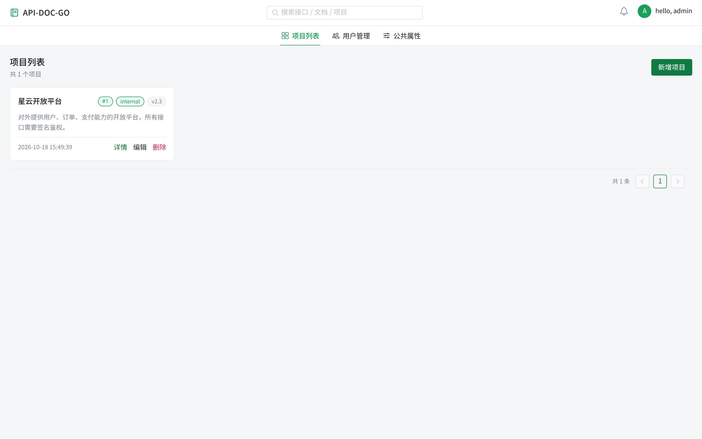
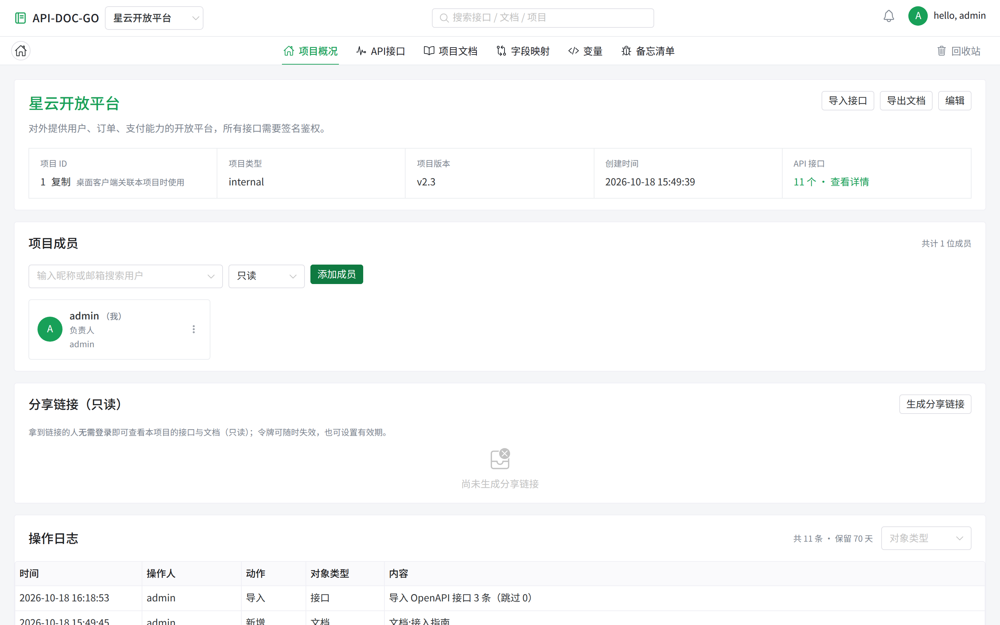
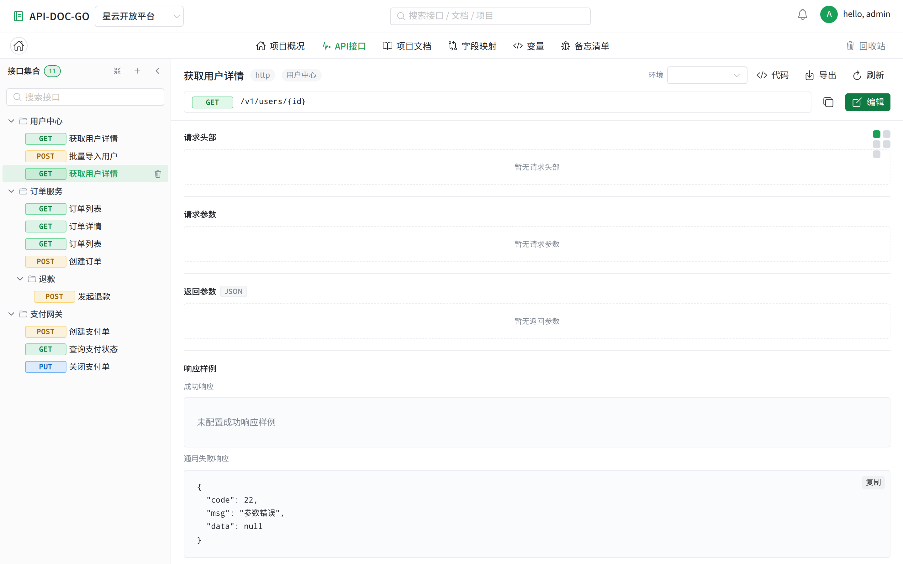
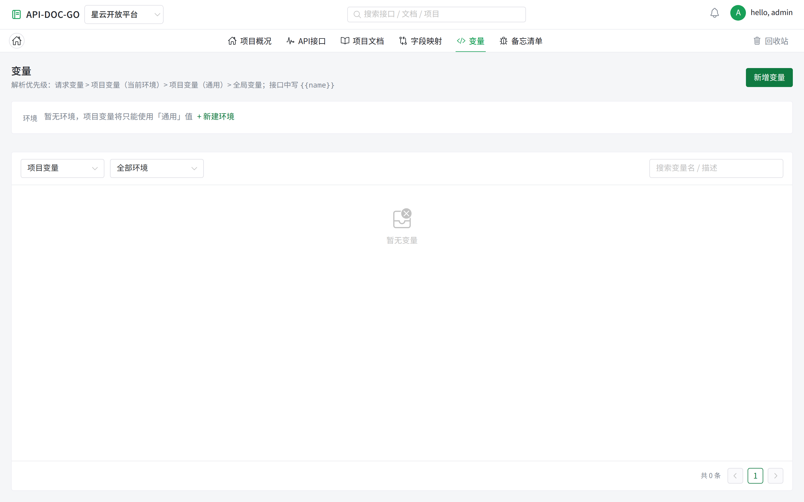
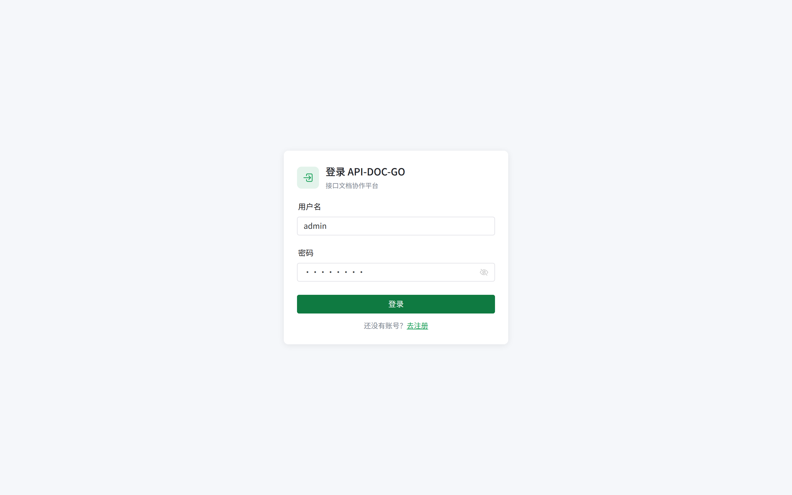

# api-doc-go Web 端 UI 评审

> 评审日期：2026-10-18 · 对象：`api-doc-go/web`（Vue3 + Naive UI 管理端，对 `/api/v1`）
> 结论口径：**页面简洁明了 / 重要信息容易读 / 开箱即用**
> 附件：`screenshots/`（12 张实机截图）、`serve-dist.mjs`（本地起生产产物 + /api 代理）

---

## 0. 一句话结论

信息架构是对的（顶栏 + 页签 + 项目内六分区），中文文案、空态、成员/日志/分享这些"管理端该有的"都在；
但**两个功能性 P0 挡住了它**：带登录态刷新即白屏、OpenAPI 导入丢参数。
UI 层的主要问题是**留白与密度失衡**（卡片固定 250px、空态动辄 150px、三栏信息条排错列）与**主色对比度不足**。

| 维度 | 评分 | 主要扣分项 |
| --- | --- | --- |
| 简洁明了 | 6.5 / 10 | 项目卡片固定宽度导致大面积空白；tab 与 H1 重复；接口详情三个空区块 |
| 重要信息容易读 | 6.0 / 10 | 主色白字 3.38:1；信息条 4 列放 5 项；响应样例单行压缩 |
| 开箱即用 | 6.5 / 10 | 无"示例项目/演示数据"；注册/登录页无默认账号提示；空态无下一步动作 |
| 稳定性（本轮新增） | 4.0 / 10 | 刷新白屏、导入丢参数 |

---

## 1. 评审方式

```bash
# 后端（SQLite + 独立库目录，端口 2028）
cd server && go build -o ../.tmp/ui-review-web/apidoc-server ./cmd/server
DB_DRIVER=sqlite DB_DSN=$PWD/apidoc.db PORT=2028 JWT_SECRET=... ../apidoc-server

# 前端（生产构建 + 本地静态服务 + /api 代理，避开 vite dev 的差异）
cd web && npx vite build --outDir dist-r6
PORT=4178 node doc/web-ui-review-2026-10-18/serve-dist.mjs dist-r6

# 截图：登录 → SPA 内导航逐页（整页刷新会白屏，见 P0-1）
```

样本：1 个项目（星云开放平台）· 3 个业务分组 + 1 个二级分组 · 11 个接口（手工 8 个 + OpenAPI 导入 3 个）· 1 篇文档 · 1 条备忘 · 1 个公共属性 · 1 位成员 · 11 条操作日志。

---

## 2. 两个 P0（必须修，已给证据与定位方向）

### P0-1 带登录态刷新 / 深链接进入受保护页 → 白屏

**复现**：登录后停在 `/projects`（或任意项目页），按 F5 或直接把该 URL 发给同事打开。

**现象**：页面全白。`#app` 里只有一个空的 `n-config-provider`：

```html
<div class="n-config-provider"><!----><!----></div>
```

**已排除**：
- 不是 dev 环境问题：`vite dev` 与生产构建产物（`vite build` + 本地静态服务）**都能复现**；
- 不是资源 404：`AppLayout-*.js`、`ProjectListView-*.js` 等 chunk 全部 200 加载；
- 不是 JS 异常：挂了 `pageerror`、`unhandledrejection`、Vue `errorHandler`、`router.onError`（本轮新增日志），**一条都没有**；
- 不是守卫拦截：URL 停在 `/projects` 没有被重定向到 `/login`（未登录访问同 URL 会正常跳登录页并渲染）；
- 不是没挂载：`document.querySelector('#app').__vue_app__` 存在。

**关键线索**：刷新后**一个业务 API 请求都没发出**（AppLayout 的 `onMounted` 未执行），说明路由组件没有被挂载——初始导航处于 pending 状态。
补充实验：把挂载改成 `router.isReady().then(() => app.mount('#app'))` 后，连 `__vue_app__` 都不存在了（`isReady` 永不 resolve），从「渲染空」退化为「不挂载」——进一步证明**首次导航挂起**。

**建议的下一步**（按成本从低到高）：
1. 在 `router.beforeEach` 前后打点（`console.log(to.fullPath, 'start', Date.now())` / `afterEach`），确认卡在哪个环节；
2. 单独做一次最小复现：把 `/projects` 路由组件换成 `LoginView`，若白屏消失 → 问题在 `AppLayout` 及其依赖链（`composables/projectNav`、`stores/project` 的 `load`）；
3. 检查 `AppLayout` 里 `watch(projectId, ..., { immediate: true })` + `project.load()` 是否在 pinia 未就绪时抛出并被吞掉（`load` 内部 catch 后不再 resolve 会让 `await` 链挂住）。

> 本轮已落地的辅助改动：`main.ts` 增加 `app.config.errorHandler`、`router/index.ts` 增加 `router.onError` 打日志——下次复现时控制台会直接给出原因（此前是"静默白屏"，只能靠猜）。

### P0-2 OpenAPI 导入只写入名称/方法/URL，参数与响应样例全部丢失

**复现**：`POST /api/v1/item/import?project_id=1&strategy=append`，body 为一份含 `parameters` / `responses.200.content.example` 的 OpenAPI 3.0 spec。

**结果**：响应 `{"imported":3,"skipped":0,"failed":0}`，但落库后：

```json
{"api_name":"订单列表","url":"/v1/orders","http_method_type":"GET",
 "http_request_params":"","http_request_header":"","http_return_params":"","http_return_sample":""}
```

spec 里的 3 个 query 参数、header 参数、响应 example 全空。对一个"接口文档平台"来说，这等于导入只能拿到骨架。

**定位方向**：`server/internal/service` 的 `ImportOpenAPI` → `share/openapi` 的解析结果是否把 parameters 映射成了 `requestParamRow`（前端期望 `{fieldName,type,required,example,description}`）；再看落库时是否只写了 `api_name/url/method`。

---

## 3. 页面观察与 UI 问题清单

### 3.1 项目列表



- **UI-01（P1）卡片固定 250px，1 个项目时右侧 3/4 空白**，分页条（"共 1 条 1"）孤零零飘在右侧中部。建议卡片 `minmax(280px,1fr)` 自适应栅格、分页条贴内容区底部。
- **UI-02（P2）页签「项目列表」与页面 H1「项目列表」重复**。全局页签已表达位置，H1 可改为项目数摘要（"3 个项目 · 最近更新 …"）或直接省略。
- **UI-03（P2）卡片操作是三个同权重文字链**（详情/编辑/删除），删除虽为红色但没有二次确认的视觉提示。

### 3.2 项目概况



- **UI-04（P1，已修）信息条 4 列却放了 5 项**，第 5 项（API 接口数）掉到第二行只占 1/4 宽、没有右边框，看起来像表格破了。→ 改 5 列 + `<1180px` 退 3 列。
- **UI-05（P1）标题用主题色**（22px / 600 / `#18a058`）：大字号勉强达标（3.38:1 ≥ 3:1），但与"可点击链接"的绿色同色，语义上像链接。建议标题用正文色，主题色只留给动作。
- **UI-06（P2）分享链接空态占 150px 高**，中间只有一个灰图标 + 一行说明，右侧"生成分享链接"按钮与空态不在同一视觉区域。
- **UI-07（P2）成员卡片信息稀**：头像 + 名字 + 「负责人」+ 账号三行，卡片 200px 宽却只有 3 行文本，右侧 `⋮` 与卡片高度不匹配。

### 3.3 接口列表 / 详情



- **UI-08（P1）三个"暂无"空区块各占 100px**（请求头部 / 请求参数 / 返回参数），中间只有一个居中灰字。对"新建接口"这种常见场景，首屏 60% 是空白。建议：空区块高度压到 56px，并在区块内给一个"添加一行"的入口（而不是只能点右上"编辑"）。
- **UI-09（P1）响应样例格式不一致**：成功样例是**单行压缩 JSON**（长到要横向看），通用失败样例是格式化 JSON。建议统一走 `JSON.stringify(obj, null, 2)` 或统一给「格式化」开关。
- **UI-10（P2）右上角 4 个灰色小方块**（操作按钮占位）没有图标/文字，鼠标悬停才知道是什么。
- **UI-11（P2）内容区无最大宽度**：1440px 下正文行宽接近 1100px，长 URL / 长 JSON 阅读成本高。建议正文区 `max-width: 960px` 居中（表格类可例外）。
- **UI-12（P2）左侧树重名接口无区分**（导入后出现两个「获取用户详情」），只能靠路径 hover 区分。

### 3.4 变量 / 备忘 / 用户 / 属性



- **UI-13（P2）变量页顶部绿条一句话塞两种语义**：「环境 暂无环境，项目变量将只能使用「通用」值 + 新建环境」——现状 + 后果 + 动作挤在一行，建议拆成"提示 + 主按钮"两段。
- **UI-14（P2）空态只有"暂无变量"**，没有"新建变量"的引导（按钮在右上角，视线跳很远）。

### 3.5 登录页



- **UI-15（P2）卡片 310px 偏窄**，标题与副标题字号接近（14/12），层级弱；无「忘记密码」与默认账号提示（内网工具常见 admin/admin123，首次使用者会卡住）。

---

## 4. 本轮已落地的改动

| 项 | 改动 | 文件 |
| --- | --- | --- |
| P0-1 辅助 | 加 `app.config.errorHandler` + `router.onError` 日志（白屏不再静默） | `src/main.ts`、`src/router/index.ts` |
| UI-04 | 项目概况信息条 4 列 → **5 列**（窄屏 3 列） | `views/project/ProjectOverviewView.vue` |
| UI-16 | 主色 `#18a058` → **`#0f7a41`**（白字 3.38:1 → 5.41:1，hover 4.92:1） | `src/App.vue` |
| — | `.gitignore` 增加 `dist-*/`（本地多地构建产物不误提交） | `web/.gitignore` |

**未做**：P0-1 根因修复（需要更细的导航打点，已给三步定位方案）、P0-2 导入映射修复、UI-01/05/08/09 等布局与文案项。

---

## 5. 建议的修复顺序

1. **P0-1 刷新白屏**（阻断级：用户按 F5 就废，且分享链接不可用）；
2. **P0-2 OpenAPI 导入丢参数**（核心功能失效）；
3. UI-01 项目卡片自适应、UI-08 空区块压缩 + 就地添加入口、UI-09 响应样例统一格式化；
4. UI-05 标题色、UI-11 内容区最大宽度、UI-02 标题去重；
5. 其余 P2：空态引导、成员卡片、登录页提示、树重名。

---

## 6. 与客户端评审的关系

同一天的两份评审（`api-doc-go-client/doc/ui-review-2026-10-18`）暴露了同一个根因：**主色既当品牌色又当动作色**（白字不足 4.5:1）。两端现在都改成了 `#0f7a41`，建议后续把这条写进各自的设计令牌说明，避免再回退。
